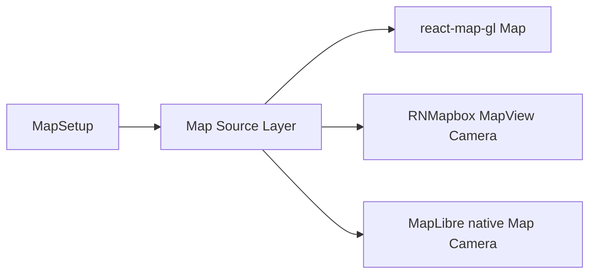

# TF02 shared map record

**TF02 complete, 2026-10-10.** The shared Seattle route example passed in all six environments. The facade matches the pinned wrappers. MapLibre web, iOS, and Android passed the approved scenario. Mapbox web and iOS passed it after the public token moved to the shell variable. Mapbox Android flew to the north end, showed the line, and remount created a new map. That map opened at longitude 0, latitude 0, which is pinned `@rnmapbox/maps` 10.3.7 on a cold style cache: `Camera` `defaultSettings` goes through a zero-duration `flyTo`, the center is written while zoom is still 0, and Mapbox's height constraint keeps the latitude at 0. The facade passes the same stop. Stock RNMapbox reproduces the opening frame. The upstream fix is [pull request #4332](https://github.com/rnmapbox/maps/pull/4332) for [issue #4273](https://github.com/rnmapbox/maps/issues/4273). Drop this peer limitation when the pinned release contains that fix. The [Android camera handoff](tf02-android-camera-handoff.md) is the investigation record. Full camera, source, and layer coverage remain later stages. Map reuse remains TF03.

The public props cover this example only. `Source` accepts `type: "geojson"`, a required id, and object `data`. `Layer` accepts `type: "line"` and the line paint and layout fields used by the example. Future source and layer families stay documented in [sources and layers](sources-and-layers.md). Where a wrapper already rejects a bad value, that failure surfaces. If the camera ref is missing when `flyTo` is called, the promise rejects because there is no method to invoke. MapLibre Native also rejects `flyTo` until the map reports that its style finished loading, because an earlier `setStop` can resolve after the native map drops the stop.

## Architecture trace

`MapSetup` places the selected adapter on React context. Shared `Map`, `Source`, and `Layer` read that context and render the adapter components. The common entry imports React only; it does not import `react-map-gl`, Mapbox GL JS, MapLibre GL JS, `@rnmapbox/maps`, or `@maplibre/maplibre-react-native`.

Creation: `Map` in `packages/one-map-react/src/map.tsx` renders `adapter.Map`. Web adapters in `create-web-adapter.tsx` render react-map-gl `Map` from `react-map-gl/mapbox` or `react-map-gl/maplibre`. RNMapbox renders `MapView` plus a `Camera` child. MapLibre Native renders `Map` plus a `Camera` child.

Source: common `Source` renders `adapter.Source`. RNMapbox uses `ShapeSource` with `shape`. MapLibre Native uses `GeoJSONSource` with `data`. Web forwards `Source type="geojson"` and `data` to react-map-gl.

Layer association: common `Layer` remains the direct child of the wrapper source. RNMapbox `ShapeSource` clones children and injects `sourceID`; MapLibre Native `GeoJSONSource` and react-map-gl `Source` inject `source`. `Layer` forwards whichever injected prop arrives.

`flyTo`: `MapRef.flyTo` adopts the wrapper result through `invokeWrapper`. RNMapbox calls `Camera.setCamera` with `animationMode: "flyTo"` and resolves after that synchronous void return. MapLibre Native awaits `Camera.flyTo`, which returns the `setStop` promise, after `onDidFinishLoadingMap`. Web calls react-map-gl `flyTo`, which returns the map instance; the facade resolves after that non-thenable return. Fulfillment does not mean the animation finished. A missing camera ref rejects without calling the wrapper. MapLibre Native also rejects before style load, without calling the wrapper.

`onMove`: web maps `react-map-gl` `onMove` through `moveEventFromWeb`. RNMapbox maps `onCameraChanged` through `moveEventFromRnmapbox`. MapLibre Native maps `onRegionIsChanging` through `moveEventFromMaplibreNative`. The payload is `{ viewState, origin }`. `origin` is `user` when the wrapper reports a user gesture, otherwise `unknown`.

The only extra state is adapter context, a frozen copy of the first `initialViewState`, an active-callback guard so `onMove` stops after unmount, and a MapLibre Native flag set when the map reports style load.

## Checks

`bun run validate` is the fast routine command: format, docs, types, Jest Testing Library mounts plus conversion tests, and packed-package selection without wrapper installs. Jest 29 with `@react-native/jest-preset` is the runner that mounted both web (`@testing-library/react`) and native (`@testing-library/react-native`) examples.

`bun run test:peers` packs the library into OS-temp consumers that install only one selected peer set. `bun run test:example-resolution` installs a temporary Vite shell with the sibling `shared` tree and asserts that React and `one-map-react` resolve from that shell. Neither command is part of `validate`.

Runtime acceptance is the six-environment smoke below. Generating native `ios/` and `android/` with `scripts/setup-native-example.mjs` shows scaffolding; it does not show that an app builds.

## Acceptance request

Checkpoint: TF02 shared map implementation. Permission was given for this smoke, then again for Mapbox only. All six environments passed. Mapbox Android's opening camera matches pinned `@rnmapbox/maps` 10.3.7: longitude 0, latitude 0 on a cold style cache, then Fly north to the route.

Proposed artifact: packed `one-map-react` tarball SHA-256 `b47b647d5a33c46ea074e5eaa5dde43b62d7514f35c5a8d4e21f79befad5104f`, recorded in [the evidence file](../records/evidence/tf02-shared-map.json).

Environments: Mapbox web, MapLibre web, Mapbox iOS, Mapbox Android, MapLibre iOS, MapLibre Android.

Web setup, from the repository root: `bun run build`. Then from `examples/web-mapbox` or `examples/web-maplibre`: `bun install`, then `bun run dev`. The package exports point at `dist/`, which is gitignored until that build. Mapbox shells read `MAPBOX_ACCESS_TOKEN` from the shell or a gitignored `.env` file. Copy `.env.example` to `.env` and set the public token, or export the variable before starting the shell. Do not commit a token.

Native setup, from the repository root: `bun run build`, then `bun scripts/setup-native-example.mjs native-mapbox` or `native-maplibre`. Then from the example root: `bun install`; for iOS `bundle install`, `bundle exec pod install` in `ios`, then `bun run ios`; for Android `bun run android`. Mapbox native reads the same `MAPBOX_ACCESS_TOKEN` variable or `.env` file as Mapbox web. The Metro process must see it. Each native example must not install the opposite maps package.

Scenario: mount the shared Seattle route map, confirm the GeoJSON line, press Fly north, observe `onMove` logs, press Remount, and confirm a fresh map rather than a reused instance.

Estimated duration: about one to two hours for all six environments, including native generate, pod/Gradle, and simulator or device install.

Permission applies only to this smoke. Retries or a later artifact need a new request.
